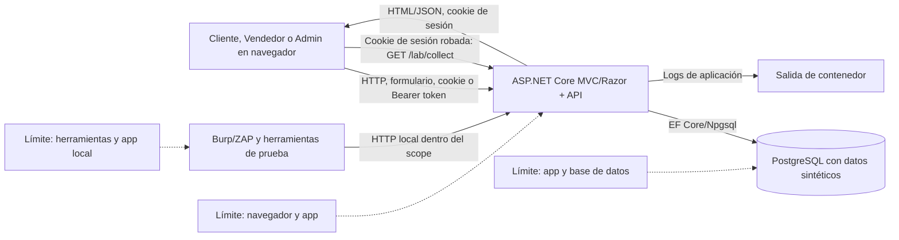

# Data Flow Diagram (DFD) — Fase 1

> **Entorno multi-OS del hito:** el código puede desarrollarse en Windows o Linux; el contenedor de referencia es Linux y Docker Compose, el objetivo y las herramientas de pentest se ejecutan dentro de Debian 13 XFCE en la VM del laboratorio. Los comandos de los runbooks se ejecutan desde esa VM y el objetivo es exclusivamente `http://127.0.0.1:5080` dentro del invitado.

**Estado:** diseño inicial de la solución planificada. Ajustar y versionar después de aprobar rutas/componentes y nuevamente después de construir el MVP. No presentar el diagrama como verificado hasta contrastarlo con la app real.

## Trust boundaries

1. **Navegador → app:** formularios, parámetros, IDs, cookies y tokens son entrada no confiable. La interfaz no constituye autorización.
2. **Herramientas → app:** Burp, ZAP y sqlmap solo apuntan a la URL loopback acordada; los datos/cookies usados son de prueba.
3. **App → PostgreSQL:** conexión y consultas cruzan el límite de proceso/datos; para el escenario vulnerable se introduce solo el fallo planificado en búsqueda. El resto del seed es sintético.
4. **Navegador → app (`/lab/collect`):** flujo especial de evidencia XSS; el contenido almacenado hace que el navegador envíe la cookie de sesión del usuario ficticio a un endpoint del mismo contenedor.
5. **Contenedor → host/red:** puerto publicado solo en `127.0.0.1`; no publicar en interfaces de red ni Internet.

## Assets and entry points

**Activos:** credenciales sintéticas, identidad/roles, catálogo/precios, comentarios, carrito/pedidos, cookie de sesión del usuario ficticio, JWT de laboratorio, disponibilidad e integridad de registros.

**Puntos de entrada:** `/Account/Login`, `/Products/*`, `/Cart/*`, `/Seller/*`, `/Admin/*`; API `/api/auth/login`, `/api/products/search`, `/api/products/{id}/comments`, `/api/cart/{cartId}`, `/api/orders/{orderId}`, `/api/admin` y `/lab/collect`. El scaffold actual solo expone salud y consulta de productos; contrastar este diseño con las rutas efectivamente implementadas antes de la entrega.

**Flujos a verificar:** login devuelve credencial de sesión/token; búsqueda consulta PostgreSQL; comentario se persiste y vuelve a la vista; operaciones de carrito/pedido leen/escriben recursos por ID; llamada administrativa evalúa el rol; herramientas de prueba observan requests/responses locales.
